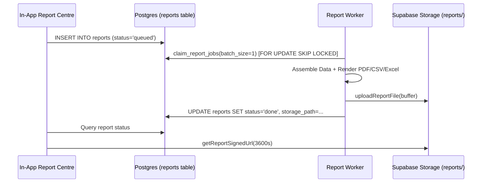

# Reports and Exports Architecture

## Overview

JalMaps Phase 23 provides one-click, localized PDF reports for wells, villages, and districts, CSV and Excel data exports, automated scheduled weekly/monthly digests, and expiring share links, all respecting role scopes and the $N \ge 3$ privacy threshold.

---

## 1. Design Decision & Engine Selection (ADR 0006)

During the Phase 23 spike, we compared `@react-pdf/renderer` (pure JavaScript) with Headless Chromium (Playwright) across all 11 supported Indic scripts (Hindi, Marathi, Punjabi, Gujarati, Bengali, Tamil, Telugu, Kannada, Malayalam, Odia):

- **Pure JS Engines (`@react-pdf/renderer`)**: Failed OpenType HarfBuzz conjunct shaping. Complex Indic ligatures (Devanagari conjuncts like क्ष, त्र, ज्ञ, and matra placement) rendered with detached viramas or missing glyphs. Additionally, React 19 compatibility conflicts blocked serverless integration.
- **Headless Chromium (Playwright)**: Renders full CSS Paged Media (`@page { size: A4; margin: 15mm; }`), OpenType font features (`font-feature-settings: "liga" 1`), and embeds Google Noto Sans font families for flawless typography across all 11 Indian languages.

**Accepted Decision**: Use Headless Chromium worker for vector PDF generation with server-rendered SVG charts.

---

## 2. Report Types

| Report Type                      | Audience                   | Key Sections                                                                                                     | Data Source & Privacy                                                 |
| :------------------------------- | :------------------------- | :--------------------------------------------------------------------------------------------------------------- | :-------------------------------------------------------------------- |
| **Well Report**                  | Farmers                    | Current Depth, 30d Trend, Battery & Signal, Health Score, Alerts, Data Quality                                   | User-owned well or assigned village                                   |
| **Village Overview Report**      | Village Admins & Officials | Aggregate Depth, Stress Score Breakdown, Online Sensors, Well Table, Boundary Outline, Alerts                    | $N \ge 3$ threshold: if $< 3$ wells, individual depths & names masked |
| **District Groundwater Summary** | Officials & Insurers       | District KPIs, Village Stress Rankings, Depletion Rates, Critical Villages Count                                 | Aggregated across administrative blocks                               |
| **Subsidy & Recharge Planning**  | Officials & Planners       | Prioritized Villages Ranked by Stress & Depletion, Offline Node Counts, Recharge Suitability, Methodology Notice | No invented metrics; grounded in observed sensor readings             |

---

## 3. Data Assembly & Privacy Thresholds

The pure assembly service (`src/server/reports/service.ts`) enforces strict data access rules:

1. **Role Scope Enforcement**: No report contains data that the requesting user cannot view on screen.
2. **Minimum Sample Size ($N \ge 3$)**:
   - If a village has fewer than 3 reporting wells, individual well names, coordinates, and exact depth values are masked (`privacyMasked: true`).
   - District-level reports flag masked villages to prevent re-identification.
3. **No Invented Telemetry**: Subsidy and recharge recommendations are computed solely from measured recharge response (`monsoonRechargeM`), depletion slope (`depletionRateMPerYear`), and sensor uptime. Electricity and pumping figures not monitored by the hardware are strictly omitted.

---

## 4. Export Formats

- **PDF**: A4 vector document with embedded Google Noto fonts, header/footer page numbers, server-side SVG trend sparklines, and a QR code linking to the live dashboard.
- **CSV**: UTF-8 BOM (`\uFEFF`) prefixed so Microsoft Excel displays non-Latin Indic script headers without encoding corruption.
- **Excel (`.xlsx`)**: Generated via `exceljs` with styled header rows, alternating grid shading, formatted numeric cells, and a dedicated **Data Dictionary** worksheet documenting each column's definition and unit.

---

## 5. Asynchronous Queue & Storage Architecture

- **Auto-Deletion**: All report records and storage objects auto-expire after 30 days (`expires_at = now() + interval '30 days'`).
- **Access Control**: RLS policies enforce `created_by = auth.uid()` for download and delete operations.

---

## 6. Scheduled Digests

Configured in `report_schedules`:

- **Cadence**: Weekly (Monday 04:00 UTC) or Monthly (1st of month 04:00 UTC).
- **Delivery Channel**: Email, SMS, WhatsApp, or In-App.
- **Outbox Integration**: Enqueues notification outbox events with type `digest`.
- **One-Tap Unsubscribe**: Every scheduled message includes a direct URL:
  `https://jalmaps.in/api/reports/unsubscribe?token={schedule_id}:{user_id_hash}`

---

## 7. Expiring Share Links

Configured in `report_shares`:

- **Security**: Raw tokens are never stored plaintext; only SHA-256 hashes (`token_hash`) are persisted.
- **Capped Expiry**: Maximum expiration is strictly capped at 30 days.
- **Access Tracking**: Increments `access_count` and updates `last_accessed_at` on every resolution.
- **Revocation**: One-click revoke marks `revoked_at = now()`, immediately invalidating access.

---

## 8. Visual Review Checklist for Indic Scripts

When adding or modifying report templates, verify the following checklist in all 11 supported languages:

- [ ] **Devanagari (Hindi, Marathi)**:
  - Conjuncts (e.g. क्त, त्र, ज्ञ, श्र) shape into single glyphs, not isolated letters with halant.
  - Short 'i' matra (ि) renders to the left of the consonant cluster.
  - Reph (र्) renders above the following consonant.
- [ ] **Gurmukhi (Punjabi)**:
  - Tippi (ੰ) and Bindi (ਂ) center correctly above consonants.
  - Subscript letters (Rara, Haha, Vava) attach below the base character.
- [ ] **Gujarati**:
  - Matras attach cleanly without colliding with ascenders.
- [ ] **Bengali**:
  - J-conjuncts and sub-glyphs shape correctly.
- [ ] **Dravidian Scripts (Tamil, Telugu, Kannada, Malayalam)**:
  - Split vowel signs (e.g. Tamil கொ) enclose the base consonant properly.
  - Subscript consonants in Kannada and Telugu render below the base letter.
  - Chillu characters in Malayalam render as standalone consonants.
- [ ] **Odia**:
  - Top matras do not overlap with letter crowns.
- [ ] **Layout & Margins**:
  - Tables do not wrap Indic compound words awkwardly.
  - Numbers format with Indian grouping (`12,34,567`).
